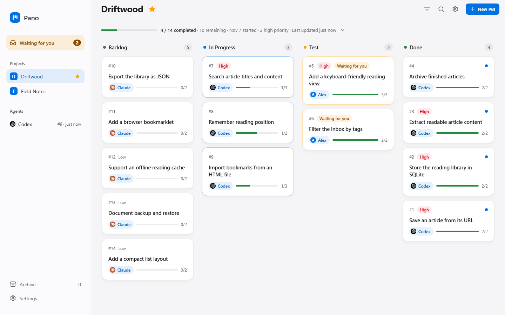
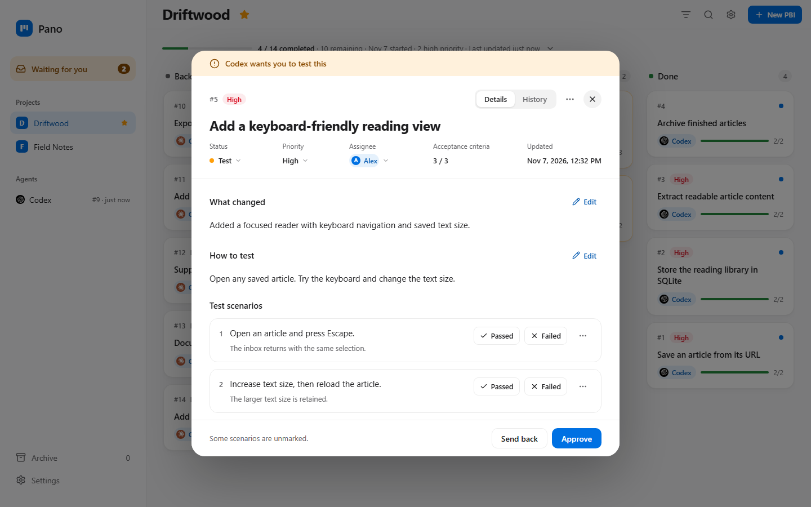
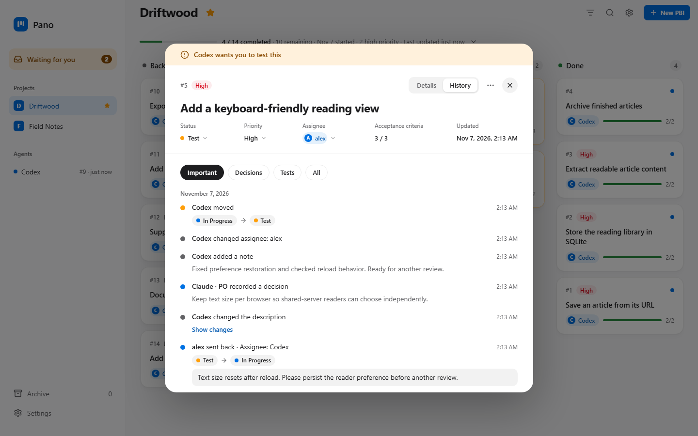
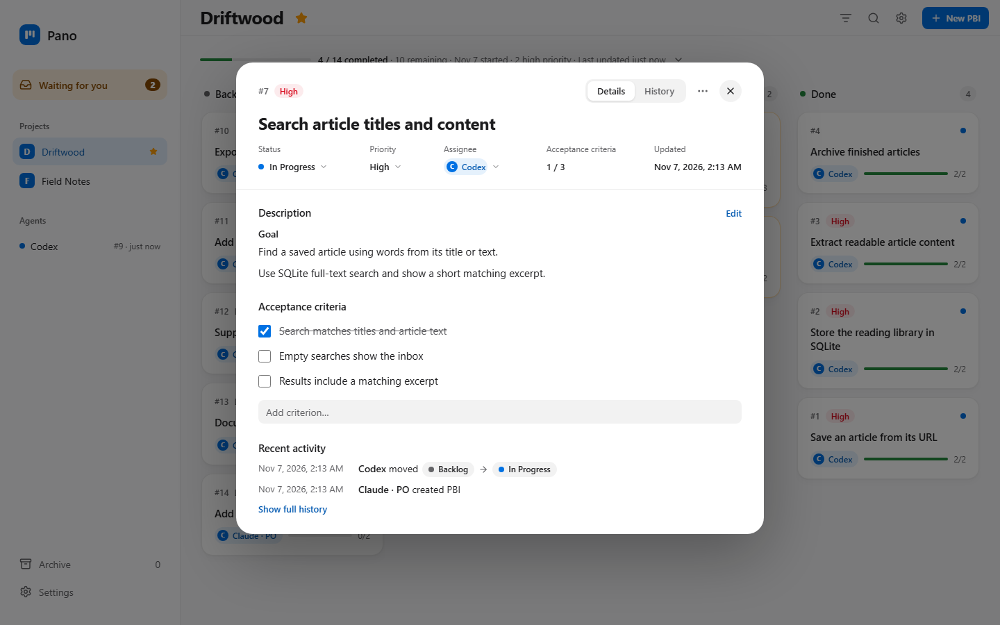
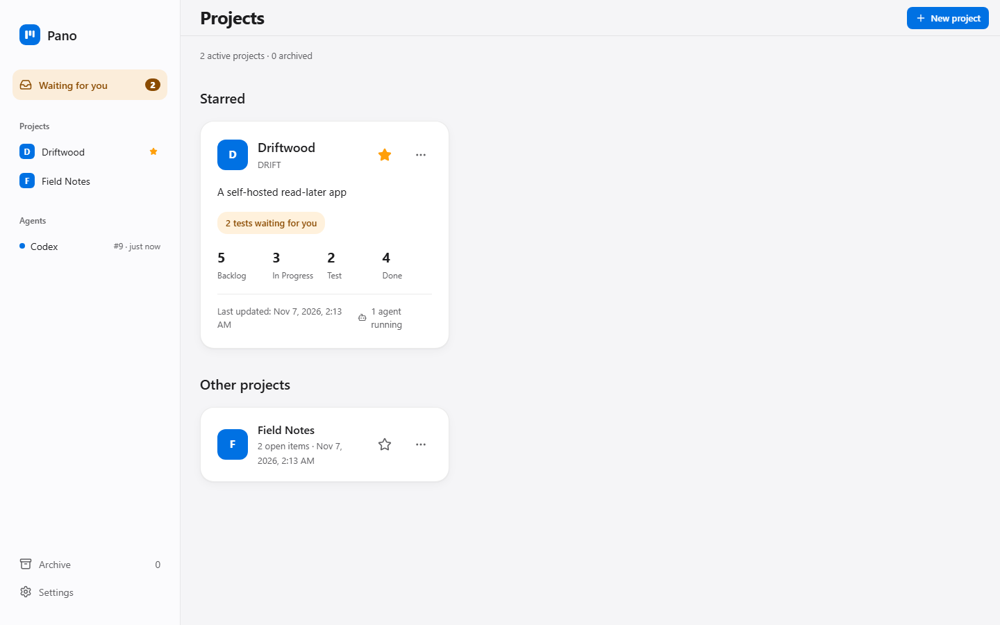

# Pano

Pano is a self-hosted project board where AI agents track their work and you review the results.



## Why it exists

AI agents do the work. You need somewhere to see what they are doing, what changed, and what needs your attention. Pano keeps that information in one place, with a web interface, REST API, MCP endpoint, CLI and SQLite database in a single executable.

## How it works

An agent creates PBIs through MCP, CLI or REST, moves them through Backlog and In Progress, and records decisions and automated checks. Pano tracks agents; it does not run them.

When a change needs human testing, the agent adds a change summary, instructions and scenarios, assigns it to you, and moves it to Test. You try it, mark scenarios and approve it into Done, or send it back with a note and optional screenshots. Failed scenarios prevent approval. Projects can also allow agents to close work that does not need human testing.

No activity record is deleted during this workflow. Edits retain their previous and new values; cancelled PBIs keep their history and can be restored. Permanently deleting a project is a separate action that requires confirmation.

## Features

- Live board updates, priorities, assignments, and light and dark themes.
- Human test scenarios, AI check records, and approval or send-back notes.



- Activity history with decisions, status changes and text diffs.



- Markdown descriptions and acceptance criteria on each PBI.



- Multiple projects, starred projects, archives, and a cross-project waiting list.



## Installation

Build from source for now. This checkout has no release tags, and published binaries or registry images could not be verified. The [release workflow](.github/workflows/release.yml) is configured to publish binaries and `ghcr.io/metonya/pano` on a `v*` tag. Check [GitHub Releases](https://github.com/metonya/pano/releases) for availability before using the download instructions below. If releases are not published yet, use the source or local Docker build below.

### Build from source

Install Bun 1.3 or newer, then run from the repository root:

```sh
bun install
bun run build:bin
```

Run `./dist/pano serve` on macOS or Linux, or `./dist/pano.exe serve` on Windows. Open `http://localhost:7777`. Stop the server with Ctrl+C. The executable includes the web interface and needs no separate frontend process.

### Release binaries

When a release is available, download the file for your platform. You can verify its SHA-256 checksum against that release's `SHA256SUMS.txt`.

| Platform | File | Start command |
| --- | --- | --- |
| Windows x64 | `pano-windows-x64.exe` | `./pano-windows-x64.exe serve` |
| macOS Apple Silicon | `pano-darwin-arm64` | `./pano-darwin-arm64 serve` |
| macOS Intel | `pano-darwin-x64` | `./pano-darwin-x64 serve` |
| Linux x64 | `pano-linux-x64` | `./pano-linux-x64 serve` |
| Linux ARM64 | `pano-linux-arm64` | `./pano-linux-arm64 serve` |

On macOS and Linux, first run `chmod +x <downloaded-file>`. Run the start command from the download directory and open `http://localhost:7777`.

### Docker

Until the registry image is published, build it locally from the repository root:

```sh
docker build -t ghcr.io/metonya/pano:latest .
docker run -d --name pano -p 7777:7777 -e PANO_TOKEN=YOUR_TOKEN -v pano-data:/data ghcr.io/metonya/pano:latest
```

Replace `YOUR_TOKEN` with a strong token. Open `http://localhost:7777` and enter the same token in the web interface. Data stays in the `pano-data` volume. Once the image is published, you can pull `ghcr.io/metonya/pano:latest` instead of building it.

For Compose, set `PANO_TOKEN` in your environment and use [docker-compose.example.yml](docker-compose.example.yml). With the local image already built:

```sh
docker compose -f docker-compose.example.yml up -d --pull never
docker compose -f docker-compose.example.yml down
```

After publication, `docker compose -f docker-compose.example.yml up -d` can pull the image. `down` preserves the data volume.

### Configuration

| Variable | Purpose |
| --- | --- |
| `PANO_PORT` | Server port, default `7777` |
| `PANO_HOST` | Bind address, default `127.0.0.1`; Docker uses `0.0.0.0` |
| `PANO_DATA_DIR` | Database and attachments directory, default `~/.pano`; Docker uses `/data` |
| `PANO_TOKEN` | Bearer token for the API and MCP; required when listening beyond loopback |
| `PANO_URL` | CLI server URL, default `http://127.0.0.1:7777` |
| `PANO_ACTOR` | Actor recorded for CLI changes, as `tool:role` (`claude:po`, `codex`) |
| `PANO_USER` | Your name until you set one under Settings, default the system account name |

## Connect an agent

Start Pano first. Set `PANO_URL` and, if required, `PANO_TOKEN` in the client environment. The CLI can print connection settings:

```sh
pano mcp-config claude
pano mcp-config codex
pano mcp-config cursor
```

The Claude output is a connection command; Codex output is TOML; Cursor output is JSON. Claude and Cursor output includes the token when set, so treat it as a secret. Codex references the `PANO_TOKEN` environment variable.

For example, Claude Code with token authentication:

```sh
claude mcp add --transport http pano http://localhost:7777/mcp --header "Authorization: Bearer YOUR_TOKEN"
```

For Codex, add the following to `~/.codex/config.toml` and provide `PANO_TOKEN` in its environment:

```toml
[mcp_servers.pano]
url = "http://localhost:7777/mcp"
bearer_token_env_var = "PANO_TOKEN"
```

For a loopback server without a token, omit the authorization header or `bearer_token_env_var`. The running server provides an agent guide at `/agents.md` and OpenAPI at `/api/v1/openapi.json`.

### CLI

Use the downloaded executable as `pano`, or replace `pano` with `bun run pano` when working from source. Running it without arguments shows help.

```sh
pano project create APP "My app"
pano project list
pano task create APP "Add search" --criteria "Matches titles" --priority high
pano task assign APP-1 codex
pano task move APP-1 in_progress
pano task note APP-1 "Search implementation started"
pano board APP
pano task show APP-1 --json
pano task check APP-1 <criterion-id>
pano task move APP-1 test
```

Statuses are `backlog`, `in_progress` (also `in-progress`), `test`, `done` and `cancelled`. Cancellation requires `--reason "Reason"`. Use `task show` to find criterion IDs; `task check KEY ID --undo` unchecks one. `task assign KEY none` clears an assignment. `project list --all` includes archives; `project star|archive KEY --off` reverses that action.

When an agent finishes a run, it can report what it used: `pano task usage APP-1 --model gpt-6.1-sol --effort high --input 12000 --output 3000 --duration 120000` (duration in milliseconds), MCP `record_usage`, or `POST /api/v1/items/APP-1/usage`. All fields are optional, but at least one is required. The card and its history then show the tokens, model and effort, marked as values reported by the agent: Pano does not run agents, so it does not measure them.

Commands support `--help` and `--json`; errors go to stderr with exit code 1. `serve --json` prints startup information and keeps the server running. The CLI uses REST, so the web board updates as it works.

To import a Markdown backlog, run `pano import backlog --project APP`. It creates a missing project, preserves statuses, priorities and acceptance criteria, and skips existing records. It also supports `--json`.

### REST

Send `Authorization: Bearer YOUR_TOKEN` when authentication is enabled, and `X-Pano-Actor` to identify who made a change:

```sh
curl http://localhost:7777/api/v1/projects \
  -H 'Authorization: Bearer YOUR_TOKEN'
curl -X POST http://localhost:7777/api/v1/projects/APP/items \
  -H 'Authorization: Bearer YOUR_TOKEN' \
  -H 'Content-Type: application/json' \
  -H 'X-Pano-Actor: codex' \
  -d '{"title":"Add search","priority":"high","criteria":["Matches titles"]}'
curl -X POST http://localhost:7777/api/v1/items/APP-1/move \
  -H 'Authorization: Bearer YOUR_TOKEN' \
  -H 'Content-Type: application/json' \
  -H 'X-Pano-Actor: codex' \
  -d '{"status":"in_progress"}'
curl http://localhost:7777/api/v1/items/APP-1/activity \
  -H 'Authorization: Bearer YOUR_TOKEN'
curl -N 'http://localhost:7777/api/v1/events?project=APP' \
  -H 'Authorization: Bearer YOUR_TOKEN'
```

## Languages

The interface supports 14 languages: English, Turkish, Azerbaijani, Chinese, Hindi, Spanish, German, French, Portuguese, Japanese, Dutch, Korean, Swedish and Polish. Translations are machine translated and open to corrections in [apps/web/src/i18n](apps/web/src/i18n). Technical terms such as Backlog, In Progress, Test, Done and PBI stay in English.

## Development

Use Bun 1.3 or newer. From the repository root:

```sh
bun install
bun run dev
bun run lint
bun run typecheck
bun run test
bun run build
```

The development web URL appears in the terminal. The API defaults to port 7777; change it with `PANO_PORT`. For browser tests, install Chromium from `apps/web` with `bunx playwright install chromium`, then run `bun run test:e2e` from the repository root.

The monorepo contains `apps/server` (Hono), `apps/web` (React, Vite, Tailwind and shadcn/ui), and `packages/core` (shared domain services). Product and architecture decisions live in [docs](docs); UI rules are in [docs/DESIGN.md](docs/DESIGN.md).

### Demo data and screenshots

Use a separate, disposable installation with a fresh data volume. Set `PANO_URL` to its web origin, for example `http://localhost:7788`, and `PANO_TOKEN` to its token. Do not target your working Pano instance.

```sh
bun scripts/demo-seed.ts
cd apps/web && node --experimental-strip-types scripts/demo-shots.ts
```

The seed creates the starred Driftwood project with 14 English PBIs and a smaller Field Notes project. It exits without changes if `DRIFT` already exists, including after an interrupted run. Use a fresh demo volume to restart an incomplete seed.

The screenshot script uses Chromium from `@playwright/test`, an English locale, and a 1440×900 viewport. It reads the seeded installation and blocks API writes. It saves `board.png`, `board-dark.png`, `detail.png`, `test.png`, `history.png`, `projects.png`, `waiting.png` and `summary.png` under `docs/images/`. A project opened today shows the summary's opening-day message until there are at least two days of chart data. These are fictional demo records; their AI check messages do not describe checks run on Pano itself.

## License

[MIT](LICENSE).
