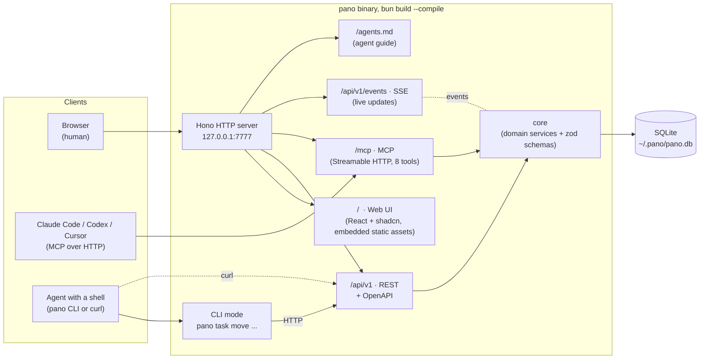
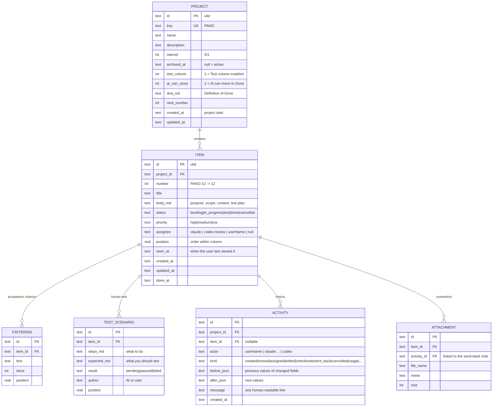

# Pano: Architecture

> Status: v0.1 draft (2026-11-05). Decisions: [`decisions.md`](decisions.md)

## In one sentence

**Pano is a single executable.** It contains the web interface, REST API, MCP endpoint, CLI, and SQLite database. The user runs either the binary or Docker image; agents connect through MCP, CLI, or plain REST.

## Component diagram



**Golden rule:** business rules live only in `core`. REST and MCP are thin adapters calling the same services. The CLI talks to the running server's REST API over HTTP (it does not touch the DB directly), so SSE events fire on every change and the board updates live.

## Operating modes

| Command | What it does |
|---|---|
| `pano serve` | Starts the server (default `127.0.0.1:7777`, DB `~/.pano/pano.db`) |
| `pano project list` / `pano board <KEY>` | Shows projects / the board in the terminal |
| `pano task create\|show\|move\|assign\|check ...` | PBI operations |
| `pano mcp-config <claude\|codex\|cursor>` | Prints the MCP connection command/JSON for the client |
| Docker | `docker run -p 127.0.0.1:7777:7777 -e PANO_LOCAL_DOCKER=1 -v pano-data:/data ghcr.io/metonya/pano` |

Environment variables: `PANO_PORT`, `PANO_HOST`, `PANO_DATA_DIR`, `PANO_TOKEN`, `PANO_URL` (server the CLI connects to), `PANO_USER` (default human identity).

## Security (v0.1)

- Binds only to `127.0.0.1` by default; no token is required.
- Local Docker: with `PANO_LOCAL_DOCKER=1`, the container listens on `0.0.0.0` and the port is published only on host `127.0.0.1`. No token is required; Host and Origin checks restrict cross-origin browser requests and DNS rebinding requests. Local processes and containers that can access the same Docker network are trusted; this mode must not be exposed to a LAN or an untrusted network.
- Other connections beyond loopback require `PANO_TOKEN`; `/api` and `/mcp` require a Bearer token. HTTPS is required for remote use.
- Multi-user accounts are outside the v0.1 scope.

## Data model



- PBI key: `<PROJECT.key>-<number>` (e.g. `PANO-12`). Agents, commit messages, and cross-project lists use this key; the interface within a project shows only `#12`.
- Priority is `high|medium|low`; the interface uses High / Medium / Low.
- Acceptance criteria have a separate table: agents can `check` them individually, and the board shows a progress bar.
- Statuses are fixed: `backlog`, `in_progress`, `test`, `done`, `cancelled`. The Test column can be disabled in project settings; `cancelled` is a filter, not a column. Workflow rules: [product.md](product.md#workflow).
- **Nothing is deleted; every change remains in `activity` with its previous/new values.** The UI displays these records for humans; by default, agents receive only the current card state + a few recent records and request the full history when needed. Recording history therefore does not increase the agent's token cost.
- Attachments (`ATTACHMENT`) are files under `PANO_DATA_DIR/attachments/`; the DB stores only metadata.

## MCP tools (deliberately few)

Every MCP tool consumes tokens in every agent conversation, so the number of tools is limited (8; `record_usage` was added on 2026-11-07 at the owner's request):

| Tool | Purpose |
|---|---|
| `list_projects` | Active projects (starred first) and project settings |
| `get_board` | A project's columns, card summaries, and work waiting for the user |
| `get_item` | Current PBI state (body, criteria, test scenarios, last 5 records); full history with `history: true` |
| `create_item` | New PBI (title, body, criteria, priority) |
| `update_item` | Status, assignee, title, body, priority, test scenarios; the `reason` field is written to history |
| `check_criterion` | Check / uncheck an acceptance criterion |
| `add_record` | Add a card record: `note`, `check` (e.g. "unit test 42/42 passed"), or `decision` |

## Repository structure

```
pano/
├─ apps/
│  ├─ server/        # Hono: REST, MCP, SSE, agents.md, static UI serving; main.ts = serve + CLI
│  └─ web/           # React + Vite + Tailwind + shadcn/ui
├─ packages/
│  └─ core/          # domain services, zod schemas, SQLite (bun:sqlite) + migrations
├─ docs/             # architecture, design (DESIGN.md), installation
└─ .github/workflows # CI + release (win/mac/linux binary, Docker image → ghcr.io)
```

## Technology choices

| Layer | Choice | Reason |
|---|---|---|
| Runtime | Bun | Runs TS directly, embedded `bun:sqlite`, single file with `--compile` |
| HTTP | Hono | Small, fast, natural fit for Bun; OpenAPI support (`@hono/zod-openapi`) |
| DB | SQLite (WAL mode) | No installation, single file, copy-and-paste backup |
| Validation | zod | REST, MCP, and CLI share the same schemas |
| MCP | `@modelcontextprotocol/sdk` Streamable HTTP | No separate client installation, just a URL |
| UI | React + Vite + Tailwind + shadcn/ui + lucide | Suits Apple-style design, components we can own |
| Drag & drop | dnd-kit | Accessible, keyboard support |
| Tests | `bun test` + Playwright (UI) | Fast, one toolchain |

## Outside the version 0.1 scope (deliberately)

Multi-user / accounts, customizable columns, sprints/calendar, notifications, immediately triggering agents (`pano watch`, webhook), GitHub synchronization. See [product.md → Open questions](product.md#open-questions-deliberately-deferred).
