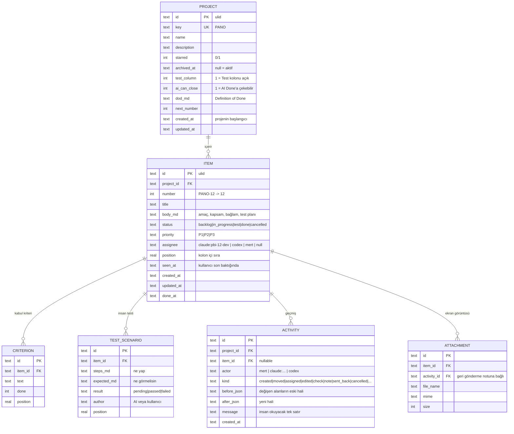

# Pano — Mimari

> Durum: v0.1 taslağı (2026-11-05). Kararlar: [`backlog/decisions.md`](../backlog/decisions.md)

## Tek cümlede

**Pano tek bir çalıştırılabilir dosyadır.** İçinde web arayüzü, REST API, MCP endpoint'i, CLI ve SQLite veritabanı vardır. Kullanıcı ister binary'yi çalıştırır, ister Docker image'ını; agent'lar MCP, CLI veya düz REST ile bağlanır.

## Bileşen çizimi


**Altın kural:** iş kuralları sadece `core` içinde. REST ve MCP ince adaptörlerdir; aynı servisleri çağırır. CLI, çalışan sunucunun REST API'sine HTTP ile konuşur (DB'ye doğrudan dokunmaz), böylece SSE olayları her değişiklikte tetiklenir ve board canlı güncellenir.

## Çalışma modları

| Komut | Ne yapar |
|---|---|
| `pano serve` | Sunucuyu başlatır (varsayılan `127.0.0.1:7777`, DB `~/.pano/pano.db`) |
| `pano project list` / `pano board <KEY>` | Projeleri / board'u terminalde gösterir |
| `pano task create\|show\|move\|assign\|check ...` | PBI işlemleri |
| `pano mcp-config <claude\|codex\|cursor>` | İlgili istemci için MCP bağlantı komutunu/JSON'unu yazdırır |
| Docker | `docker run -p 7777:7777 -v pano-data:/data ghcr.io/metonya/pano` |

Ortam değişkenleri: `PANO_PORT`, `PANO_HOST`, `PANO_DATA_DIR`, `PANO_TOKEN`, `PANO_URL` (CLI'ın bağlanacağı sunucu).

## Güvenlik (v0.1)

- Varsayılan olarak yalnızca `127.0.0.1`'e bind olur; token gerekmez.
- `PANO_HOST=0.0.0.0` (ör. Docker) ile açılırsa `PANO_TOKEN` **zorunlu**; tüm `/api` ve `/mcp` istekleri `Authorization: Bearer <token>` ister. Token yoksa sunucu başlamaz.
- Çok kullanıcılı hesaplar v0.1 kapsamı dışında.

## Veri modeli



- PBI'nın görünen anahtarı: `<PROJECT.key>-<number>` (ör. `PANO-12`). Agent'lar ve commit mesajları bu anahtarı kullanır.
- Kabul kriterleri ayrı tablo: agent'lar tek tek `check` edebilir, board ilerleme çubuğu gösterir.
- Statüler sabit: `backlog`, `in_progress`, `test`, `done`, `cancelled`. Test kolonu proje ayarıyla kapatılabilir; `cancelled` kolon değil, filtredir. Akış kuralları: [product.md](product.md#akış).
- **Hiçbir şey silinmez, her değişiklik `activity`'de eski/yeni haliyle durur.** Bu kayıtlar UI'da insan için gösterilir; agent'lar varsayılan olarak sadece kartın güncel hali + son birkaç kaydı alır, geçmişin tamamını istediğinde ister. Böylece kayıt tutmak agent'ın token maliyetini büyütmez.
- Ekler (`ATTACHMENT`) dosya olarak `PANO_DATA_DIR/attachments/` altında, DB'de sadece metadata.

## MCP tool'ları (bilerek az)

Her MCP tool'u agent'ın her konuşmasında token harcar; bu yüzden 7 tool ile sınırlı:

| Tool | Amaç |
|---|---|
| `list_projects` | Aktif projeler (yıldızlılar önce) ve proje ayarları |
| `get_board` | Bir projenin kolonları, kart özetleri, kullanıcıyı bekleyenler |
| `get_item` | PBI'nın güncel hali (body, kriterler, test senaryoları, son 5 kayıt); `history: true` ile tamamı |
| `create_item` | Yeni PBI (başlık, body, kriterler, öncelik) |
| `update_item` | Statü, assignee, başlık, body, öncelik, test senaryoları; `reason` alanı geçmişe yazılır |
| `check_criterion` | Kabul kriterini işaretle / kaldır |
| `add_record` | Karta kayıt düş: `note`, `check` (ör. "unit test 42/42 geçti") veya `decision` |

## Repo yapısı

```
pano/
├─ apps/
│  ├─ server/        # Hono: REST, MCP, SSE, agents.md, statik UI servis; main.ts = serve + CLI
│  └─ web/           # React + Vite + Tailwind + shadcn/ui
├─ packages/
│  └─ core/          # domain servisleri, zod şemaları, SQLite (bun:sqlite) + migration'lar
├─ docs/             # mimari, tasarım (DESIGN.md), kurulum
├─ backlog/          # PBI'lar (pano kendi kendini yönetene kadar md)
└─ .github/workflows # CI + release (win/mac/linux binary, Docker image → ghcr.io)
```

## Teknoloji seçimleri

| Katman | Seçim | Neden |
|---|---|---|
| Runtime | Bun | TS'i doğrudan çalıştırır, `bun:sqlite` gömülü, `--compile` ile tek dosya |
| HTTP | Hono | Küçük, hızlı, Bun ile doğal; OpenAPI desteği (`@hono/zod-openapi`) |
| DB | SQLite (WAL modu) | Kurulumsuz, tek dosya, yedeği kopyala-yapıştır |
| Doğrulama | zod | REST, MCP ve CLI aynı şemaları paylaşır |
| MCP | `@modelcontextprotocol/sdk` Streamable HTTP | İstemciye ayrı kurulum gerekmez, sadece URL |
| UI | React + Vite + Tailwind + shadcn/ui + lucide | Apple tarzı tasarıma uygun, sahiplenilebilir component'ler |
| Drag & drop | dnd-kit | Erişilebilir, klavye desteği |
| Test | `bun test` + Playwright (UI) | Hızlı, tek araç zinciri |

## Sürüm 0.1 kapsamı dışında (bilinçli)

Çok kullanıcı / hesaplar, özelleştirilebilir kolonlar, sprint/takvim, bildirimler, agent'ı anında tetikleme (`pano watch`, webhook), GitHub senkronizasyonu. Bkz. [product.md → Açık konular](product.md#açık-konular-bilerek-sonraya-bırakıldı).
